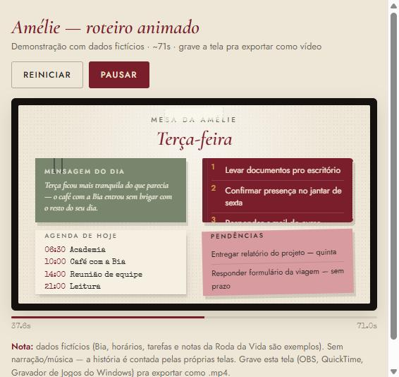

# Amélie

**A personal AI secretary, ready to use — not a project you build from scratch.**

If you already use Claude and have thought about setting up an agent that organizes your life through WhatsApp, Notion, and Google Calendar, the hard part is already done here: the personality, the design, the decision logic. Download it, connect it to your own accounts, and Amélie already knows who she is.

Amélie is calm, cultured, discreet. She knows your routine — calendar, tasks, the Wheel of Life (the 12 areas of your life) — and takes care of the details without you having to ask. She never asks "what do you want me to do" for everything — she understands the request, makes decisions within its scope, and lets you know what she did.

**What she does:**
- Organizes calendar and tasks between Google Calendar and Notion, always kept in sync.
- Resolves same-day scheduling conflicts on her own — never asks permission for that.
- Talks over WhatsApp: daily, weekly, monthly, and yearly briefings.
- Runs the monthly Wheel of Life review, with a score and justification for each area, and generates an AI summary of the month.
- Detects the language of whoever is writing (Portuguese or English) and replies in it, without asking.
- Knows how to use Gmail, Google Drive, and a potential financial agent, always under the same rule: never act without authorization on sensitive matters.

Free, under the MIT license (see [`LICENSE`](LICENSE)) — use it, copy it, modify it.

## The Wheel of Life

At the heart of Amélie is a way of looking at your whole life instead of just a task list: the **Wheel of Life**, 12 areas grouped into 4 main axes.

| Axis | Areas |
|---|---|
| 🔵 **Professional** | Social contribution · Finances and assets · Fulfillment and purpose |
| 🟢 **Personal** | Health and vitality · Intellectual development · Emotional balance |
| 🩷 **Relationships** | Family · Romantic relationships · Social life |
| 🟡 **Quality of life** | Spirituality · Plenitude and happiness · Leisure and fun |

Each axis has its own color, and each area its own shade of that color — that's how the month's map and the Google Calendar events appear color-coded in the panel: at a glance, you can see which axis of life each commitment falls into.

**How this ties into the rest:** these 12 areas aren't a standalone questionnaire — they're the same classification used for *every* task and commitment Amélie organizes in Notion and Google Calendar. The visual Wheel of Life is just the summary of all that: each slice grows or shrinks according to what's actually happening in your routine.

**The monthly ritual:** on the last Sunday of the month, Amélie runs the review — each of the 12 areas receives a score from 1 to 10, and **the score always comes with a justification for why it's that score and not another** (never just the number). From there, for any area you feel deserves to go up, you propose what you want to change — and that proposal becomes the priority for the **following month**, not the month that just ended. It's the cycle: looking back honestly, deciding a focused plan going forward, and letting Amélie remind you of it throughout the month that's starting.

## What's in here

- **`AMELIE_PERSONA.md`** — who Amélie is: origin, voice, behavior rules, how she handles the calendar, the Wheel of Life, the menstrual cycle, language, and the tools she knows how to use (Notion, Google Calendar, WhatsApp, Gmail, Drive). It's the source of truth for the personality — everything in it works for anyone, and never references any specific person's data.
- **`mesa-da-amelie.html`** — the visual panel ("Amélie's Desk"): the day's schedule, deadlines, month map, Wheel of Life, and the Amélie Menu (personalization, year-by-year history, each month's summary). Bilingual (Portuguese/English, detects on its own). No personal data is ever written into this file — each person sets up their own, once, directly in the browser.
- **`img/`** — the illustrations for the visual identity (branch, tiles, stars, stamps, flowers, and so on). The panel depends on them to look like Amélie.
- **`CONECTAR_WHATSAPP.md`** — the manual path for Amélie to talk over WhatsApp (local bridge + watcher + audio transcription). It's not automatic; it's the same path anyone using this base needs to follow once.

## Getting started

1. **Connect Notion and Google Calendar** to your own Claude account, if you haven't already (Settings › Connectors on claude.ai).
2. **Talk to Claude first, in a normal conversation** (with `AMELIE_PERSONA.md` pasted in, or as a Project's instructions). Tell it you want to set up Amélie — it'll ask your name, ask whether you already have a place in Notion for your tasks (or offer to set one up for you from a blank page), set up the databases it needs (tasks, Wheel of Life, profile) directly through the Notion connector, and then publish `mesa-da-amelie.html` as your own private Artifact, already pointed at your databases. You get a ready link back — nothing to configure, nothing to paste. **Important: that link is yours alone — never open someone else's Artifact link to set up yours**, each installation needs to stay independent from the others.
3. **If you want WhatsApp**, follow `CONECTAR_WHATSAPP.md`.

## Why there's no personal data here

This repository was designed from the start to separate two things: what Amélie is (personality, code, design — the same for anyone) from what is the user's own information (names, emails, database IDs, routine, projects). The first lives in this repository; the second is never written into the code — it stays in each person's Notion/Calendar, or stored locally in the browser. That's what makes this base safe to be public and usable by anyone, without carrying any data from whoever built it first.

## Notice

This software is distributed "as is", without warranties — see [`LICENSE`](LICENSE). Each person is responsible for their own installation, their own connections (Notion, Google, WhatsApp), and their own data. Always publish your own copy of the Artifact; never share or reuse someone else's link.
